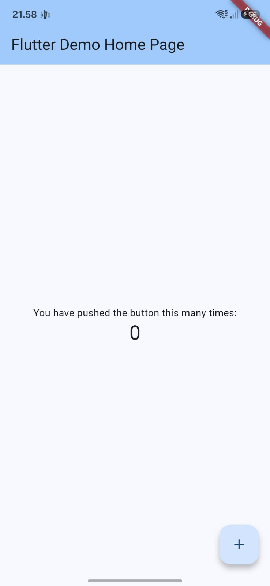
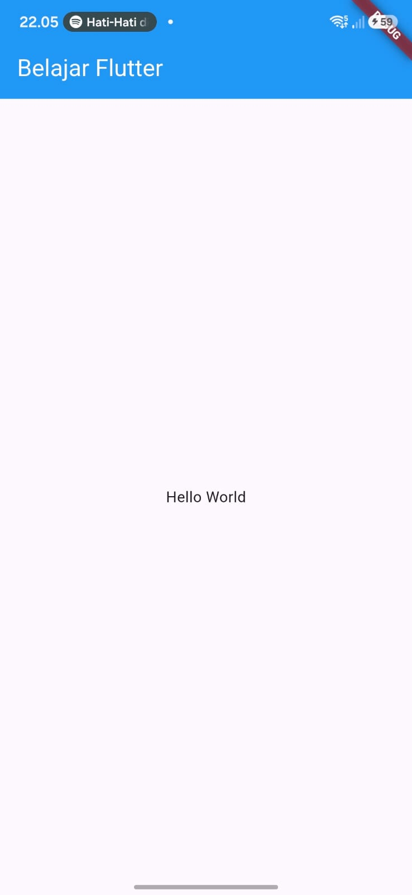
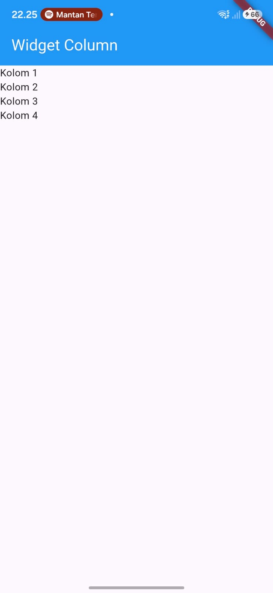
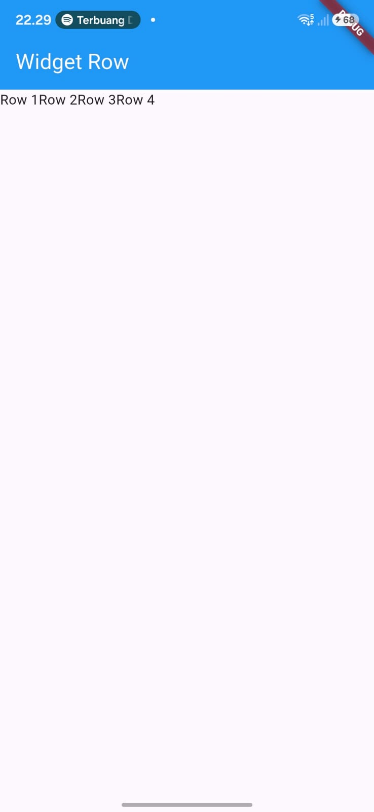
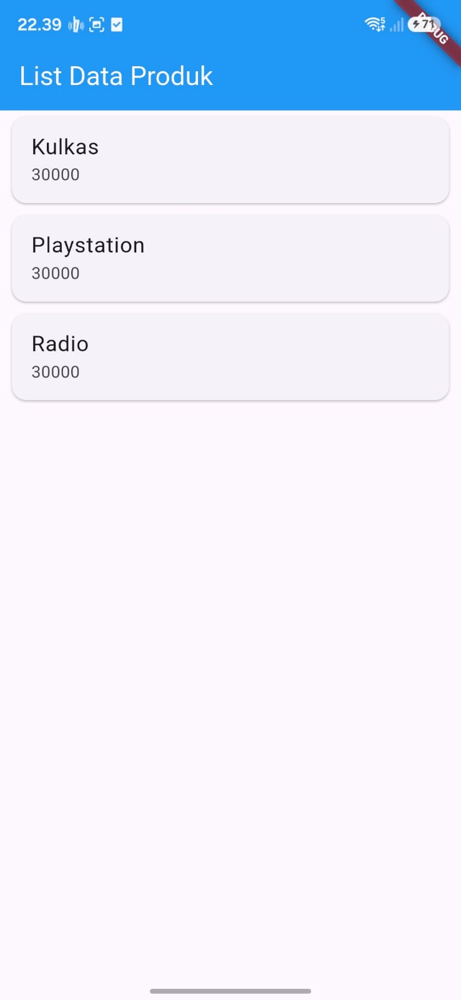

# Laporan Praktikum Pemrograman Mobile - Flutter

**Nama:** Melysa Ayu Wulan Sari  
**NIM:** H1D024046  
**Shift:** Awal D / Akhir E  
**Praktikum:** Pemrograman Mobile

---

## 📄 Tugas Pertemuan 2

**Tanggal:** Rabu, 28 Oktober 2026

### Dokumentasi Praktikum

  
  
  
  
  

### Deskripsi Teknis

Pada praktikum pertemuan pertama, kegiatan berfokus pada pengenalan framework Flutter dan dasar pengembangan aplikasi mobile menggunakan bahasa pemrograman Dart. Praktikum ini menjadi langkah awal untuk memahami struktur proyek Flutter, penggunaan widget, serta cara menjalankan aplikasi.

### Deskripsi Nonteknis

Praktikum ini memberikan pengalaman awal dalam mengenal lingkungan pengembangan aplikasi mobile. Melalui kegiatan praktikum, mahasiswa belajar memahami alur kerja pembuatan aplikasi serta pentingnya ketelitian dalam mengikuti instruksi dan menyusun kode program.

### Kesimpulan Praktikum

Praktikum pertemuan pertama memberikan pemahaman dasar mengenai pengembangan aplikasi mobile menggunakan Flutter. Pengetahuan yang diperoleh menjadi bekal untuk mempelajari berbagai widget dan membangun antarmuka aplikasi pada praktikum berikutnya.
