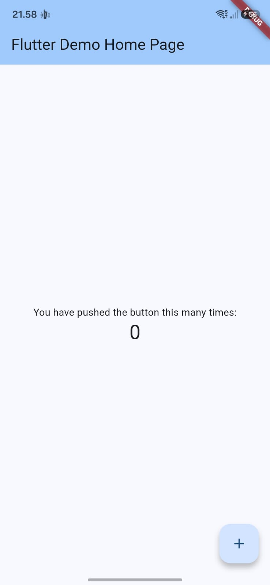
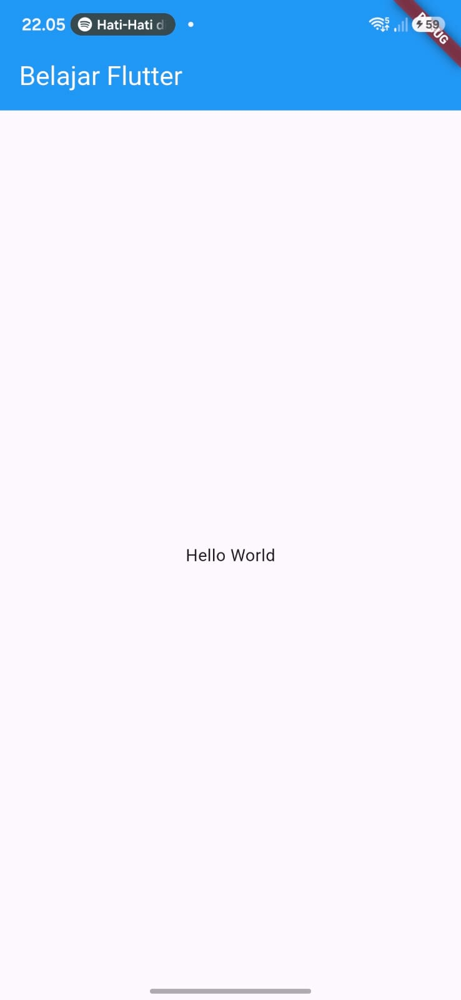
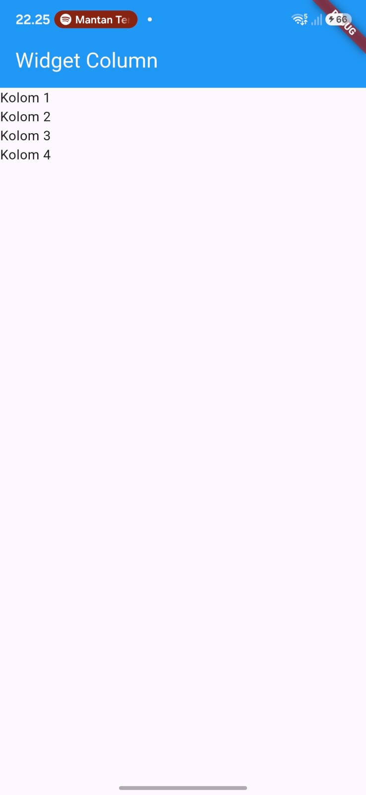
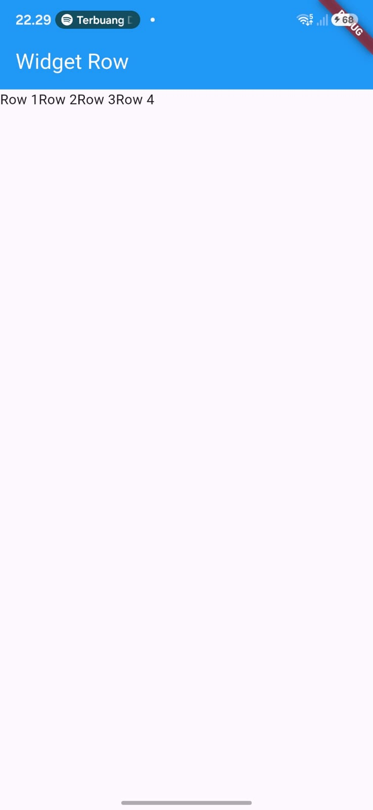
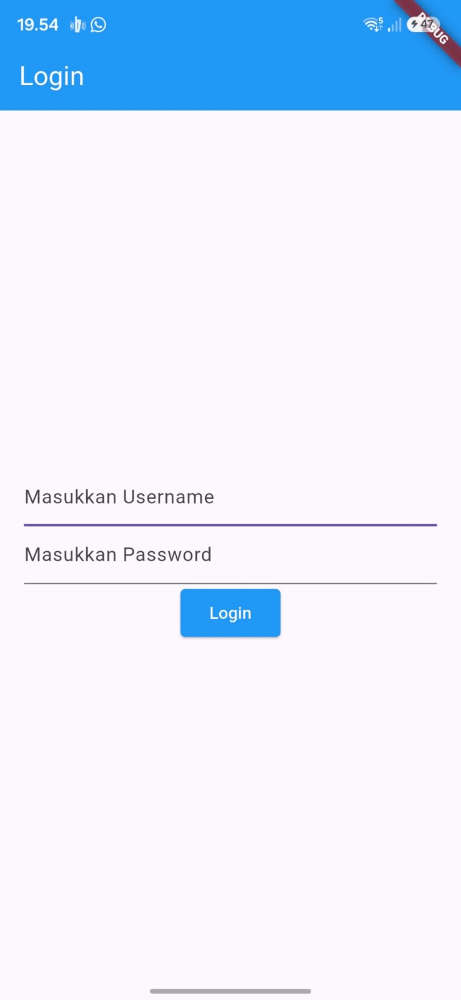
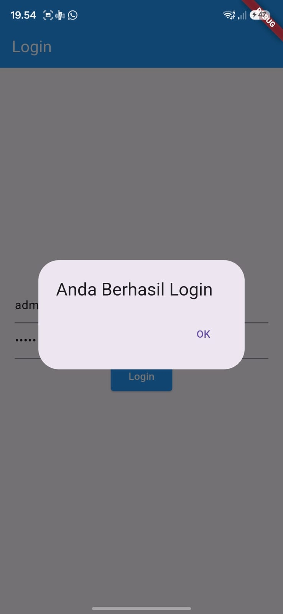
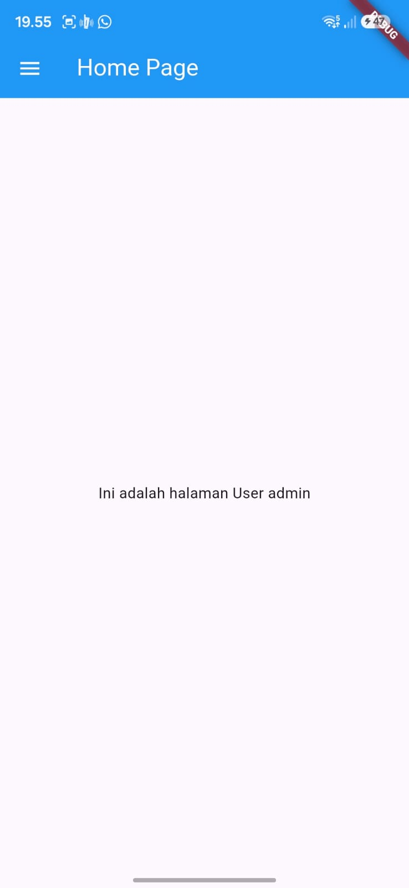
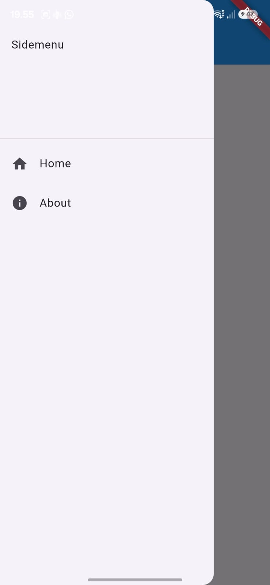

# Laporan Praktikum Pemrograman Mobile - Flutter

**Nama:** Melysa Ayu Wulan Sari  
**NIM:** H1D024046  
**Shift:** Awal D / Akhir E  
**Praktikum:** Pemrograman Mobile

---

## 📄 Tugas Pertemuan 2

**Tanggal:** Rabu, 28 Oktober 2026

### Dokumentasi Praktikum

  
  
  
  
  

### Deskripsi Teknis

Pada praktikum pertemuan pertama, kegiatan berfokus pada pengenalan framework Flutter dan dasar pengembangan aplikasi mobile menggunakan bahasa pemrograman Dart. Praktikum ini menjadi langkah awal untuk memahami struktur proyek Flutter, penggunaan widget, serta cara menjalankan aplikasi.

### Deskripsi Nonteknis

Praktikum ini memberikan pengalaman awal dalam mengenal lingkungan pengembangan aplikasi mobile. Melalui kegiatan praktikum, mahasiswa belajar memahami alur kerja pembuatan aplikasi serta pentingnya ketelitian dalam mengikuti instruksi dan menyusun kode program.

### Kesimpulan Praktikum

Praktikum pertemuan pertama memberikan pemahaman dasar mengenai pengembangan aplikasi mobile menggunakan Flutter. Pengetahuan yang diperoleh menjadi bekal untuk mempelajari berbagai widget dan membangun antarmuka aplikasi pada praktikum berikutnya.

---

## 📄 Tugas Pertemuan 3

**Tanggal:** Rabu, 4 November 2026

### Dokumentasi Praktikum

  
  
  
  

### Deskripsi Teknis

Pada praktikum pertemuan ketiga, kegiatan berfokus pada pembuatan aplikasi Flutter dengan alur halaman Login, Home, dan About yang dihubungkan melalui navigasi (routes) dan side menu. Package `shared_preferences` ditambahkan sebagai local storage untuk menyimpan username saat login, sehingga dapat ditampilkan kembali pada halaman Home.

Konsep utama yang dipelajari:
- **StatefulWidget dan TextEditingController** untuk mengambil input username dan password.
- **SharedPreferences** (`setString` dan `getString`) untuk menyimpan dan membaca data secara lokal.
- **AlertDialog** untuk menampilkan pesan hasil login.
- **Navigator.push dan MaterialPageRoute** untuk berpindah antarhalaman.
- **Drawer, DrawerHeader, dan ListTile** untuk membuat side menu.

### Deskripsi Nonteknis

Praktikum ini memberikan pengalaman membangun alur aplikasi yang lebih mendekati aplikasi sesungguhnya, mulai dari masuk (login), menyimpan data pengguna, hingga berpindah antarhalaman. Dalam prosesnya, mahasiswa belajar menghadapi kendala nyata di lingkungan pengembangan, seperti penyesuaian versi, pengaktifan Developer Mode, dan masalah kompilasi akibat lokasi cache yang berbeda drive. Hal ini melatih ketelitian dan kemampuan membaca pesan kesalahan untuk mencari solusinya.

### Kesimpulan Praktikum

Praktikum pertemuan ketiga memberikan pemahaman tentang navigasi antarhalaman, pembuatan side menu, serta penyimpanan data sederhana menggunakan local storage pada Flutter. Pengetahuan ini menjadi dasar untuk membangun aplikasi yang memiliki beberapa halaman dan data pengguna pada praktikum berikutnya.
